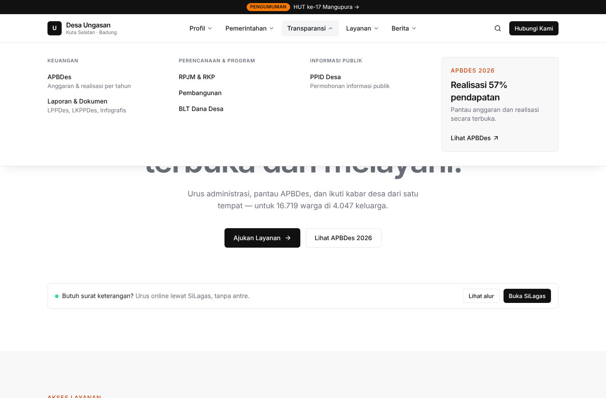

# Website Desa Ungasan — redesign open-source

Redesign [ungasan.desa.id](https://ungasan.desa.id): menu 8 dropdown bertingkat dirampingkan menjadi **5 mega-menu** (Profil · Pemerintahan · Transparansi · Layanan · Berita), dengan bahasa visual dari template [Kage](https://kage.design/design/landing-page):

| Bagian | Template acuan |
|---|---|
| Hero, tipografi, nada visual | Papermark Data Rooms |
| Bento **Akses Layanan** | Context Engine / Sponkly |
| **Desa dalam Angka** & **APBDes** | Basedash |



## Stack (100% open-source)
Next.js 15 · React 19 · TypeScript · Tailwind CSS 4 · Drizzle ORM · PostgreSQL 16 · Zod · Docker · GitHub Actions — lisensi **MIT**.

## Dokumen produk
| # | Dokumen | Agent pemilik |
|---|---|---|
| 00 | [Alur kerja agent](docs/00-AGENT-WORKFLOW.md) | — |
| 01 | [PRD — Product Requirement](docs/01-PRD.md) | Product Manager |
| 02 | [TRD — Technical Requirement](docs/02-TRD.md) | Software Architect |
| 03 | [AFD — App Flow](docs/03-AFD.md) | UX Architect |
| 04 | [DBD — Design Brief](docs/04-DBD.md) | UI Designer |
| 05 | [BSD — Backend Schema](docs/05-BSD.md) | Backend Architect + Database Optimizer |
| 06 | [IPD — Implementation Plan](docs/06-IPD.md) | Senior Project Manager |

Persona agent diambil dari [naufalnash97/agency-agents](https://github.com/naufalnash97/agency-agents) dan disalin ke [`.claude/agents/`](.claude/agents) sehingga bisa dipanggil langsung di Claude Code.

## Menjalankan

```bash
cp .env.example .env            # isi ADMIN_API_TOKEN (≥32 karakter) & IP_HASH_SALT
docker compose up -d db         # PostgreSQL
npm ci
npm run db:migrate && npm run db:seed
npm run dev                     # http://localhost:3000
```

Produksi: `docker compose up -d --build` (migrasi berjalan otomatis saat container start).

## Struktur
```
docs/                 6 dokumen produk + screenshot
.claude/agents/       persona agency-agents
drizzle/              migrasi SQL
src/db/               skema, koneksi, seed (data riil APBDes 2026 & penduduk)
src/lib/              data access, format rupiah, auth, rate-limit, markdown
src/config/           navigation.ts — struktur mega-menu
src/components/       MegaMenu, Hero, ServiceBento, StatsSection, ApbdesPanel, …
src/app/              halaman + REST API /api/v1
```

## API
Lihat [docs/05-BSD.md §4](docs/05-BSD.md). Contoh: `GET /api/v1/apbdes?tahun=2026&versi=MURNI`.

> Data APBDes 2026 dan kependudukan di seed diambil dari ungasan.desa.id per 17 Nov 2026. Isi berita/halaman masih contoh dan perlu diganti operator desa.
